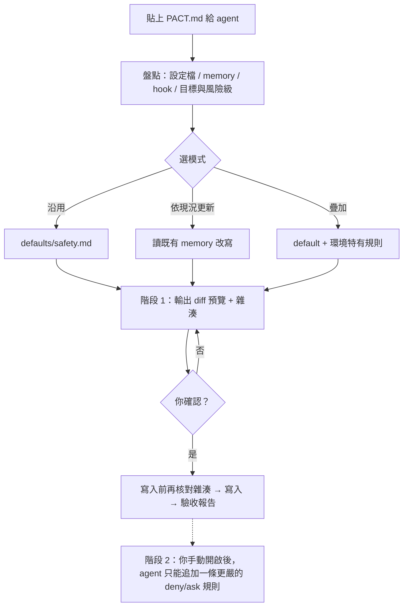

# agentpact

**一個 prompt，讓你的 AI agent 在進入環境前，先搞清楚「哪些能做、哪些不要碰」。**

> 這是 prompt，不是防火牆：它讓 agent 自我審查，**不提供強制攔截**。要強制攔截，需要平台的 hook／權限系統（agentpact 會幫你盤點有沒有）。

## 它解決什麼問題

- agent 一進到新環境（陌生主機、資料庫、repo），憑猜測就動手，做出不可逆的事。
- 你同時用好幾個 agent（Claude、Codex…），每個對「能不能碰」的理解不同，一個放行、一個拒絕。
- 每個 agent 的設定檔與 memory 格式都不一樣，用同一份樣板套下去會水土不服。

## 怎麼用（三步）

1. 打開 [`PACT.md`](PACT.md)，整份貼給你要設定的 agent。
2. agent 會先盤點自己的環境，列出「預覽」（要新增或修改的內容與 SHA-256），**停下來等你確認**。
3. 你確認後它才寫入。每個 agent 各做一次，各自依自己的 memory 與設定格式生成。

## 運作流程



純文字版：

```
PACT.md ─▶ 盤點 ─▶ 選模式(沿用/更新/疊加) ─▶ 預覽+雜湊 ─▶ 你確認 ─▶ 寫入 ─▶ 驗收報告
                                                                  └─(可選)階段 2：只准追加更嚴的規則
```

## 你會得到什麼

| 路徑 | 內容 |
|---|---|
| [`PACT.md`](PACT.md) | 產品本體，唯一要貼的 prompt |
| [`defaults/safety.md`](defaults/safety.md) | 保守預設：授權來源、風險三級、升級限制、能力檢查 |
| [`modules/boundary-check/SKILL.md`](modules/boundary-check/SKILL.md) | 選配：agent 進環境時產出「能做／要問／不碰」清單，並在高風險動作前對照 |
| [`docs/prior-art.md`](docs/prior-art.md) | 同類專案與差異 |

## 核心設計

- **預設保守**：判不出環境，一律當最高風險級；找不到紀錄不等於允許。
- **兩階段**：階段 1 人確認每次變更；階段 2（需你手動開）只准追加一條更嚴的規則，放寬或刪除一律回階段 1。
- **全部可選、先盤點**：不假設你有 herdr 或 hook。沒有的能力標「未啟用：原因」，並明說「只有操作前檢查，無強制攔截」。
- **不套樣板**：各 agent 依自己驗證過的設定與 memory 生成內容。

## 三種環境，預期的結果

- **只有 Claude**：列出實際找到的設定、memory、hook；hook 經驗證才標「有強制攔截」。
- **只有 Codex**：列出 Codex 的設定與 sandbox／批准能力；找不到的 Claude 入口標未知。
- **純聊天 agent（沒有 hook）**：只交付規則文字與預覽，標「未啟用：平台不支援」，不宣稱已安裝。

> 以上是設計預期，尚未做實跑驗證；版本為 `0.1.0-dev`，見 [CHANGELOG](CHANGELOG.md)。

## 授權

[MIT](LICENSE)
