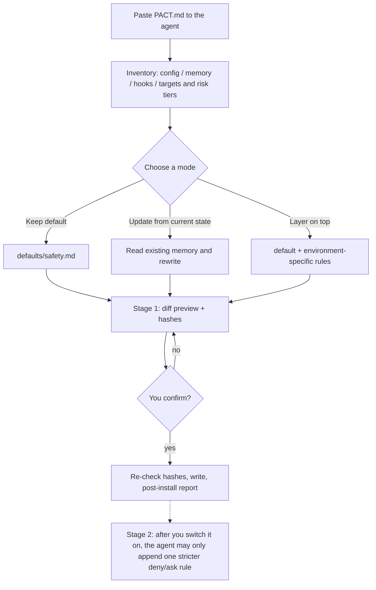

# agentpact

**One prompt that makes your AI agents work out, before they touch an environment, what they may do and what they must leave alone.**

English | [繁體中文](README.zh-TW.md)

> This is a prompt, not a firewall. It makes an agent audit itself; it does **not** enforce anything. Enforcement needs your platform's hooks or permission system (agentpact helps you inventory whether you have one).

## The problem

- An agent enters a new environment (an unfamiliar host, database or repo) and acts on guesses, doing something irreversible.
- You run several agents (Claude, Codex, ...). Each has its own idea of what is off limits, so one allows what another refuses.
- Every agent has a different config and memory format, so one template applied to all of them fits none of them well.

## How to use it (three steps)

1. Open [`PACT.md`](PACT.md) and paste the whole file to the agent you want to set up.
2. The agent inventories its own environment and shows a preview (what it would add or change, with SHA-256 hashes), then **stops and waits for your confirmation**.
3. Only after you confirm does it write. Do this once per agent; each one generates content from its own memory and config format.

## How it works



Plain-text version:

```
PACT.md -> inventory -> choose mode (keep / update / layer) -> preview + hashes -> you confirm -> write -> report
                                                                         \-(optional) stage 2: append one stricter rule only
```

## What you get

| Path | Contents |
|---|---|
| [`PACT.md`](PACT.md) | The product itself: the one prompt you paste |
| [`defaults/safety.md`](defaults/safety.md) | Conservative defaults: source of authority, three risk tiers, escalation limits, capability check |
| [`modules/boundary-check/SKILL.md`](modules/boundary-check/SKILL.md) | Optional: on entering an environment the agent produces a "can do / ask first / do not touch" list and checks it before risky actions |
| [`docs/sample-run.md`](docs/sample-run.md) | A recorded stage-1 dry run on Claude and Codex |
| [`docs/prior-art.md`](docs/prior-art.md) | Similar projects and how this differs |

## Design

- **Conservative by default**: if the environment cannot be determined, it is treated as the highest risk tier; "no record found" never means "allowed".
- **Two stages**: stage 1 has a human confirm every change; stage 2 (you switch it on) lets the agent only append one stricter rule. Loosening or deleting always goes back to stage 1.
- **Inventory first, everything optional**: it does not assume you have herdr or hooks. Missing capabilities are reported as "not enabled: reason", with the plain statement "pre-action checks only, nothing enforced".
- **No fixed template**: each agent generates content from its own verified config and memory.

## Expected results in three environments

- **Claude only**: lists the settings, memory and hooks it actually found; reports "enforced blocking" only if the hook was verified.
- **Codex only**: lists Codex's settings and sandbox/approval capabilities; Claude entry points it cannot find are marked unknown.
- **Chat-only agent (no hooks)**: delivers rule text and an install preview only, marks hooks "not enabled: unsupported by platform", and does not claim anything is installed.

> Stage 1 has been dry-run once each on Claude and Codex (see [sample run](docs/sample-run.md)); chat-only agents, stage 2 and the post-install check are not yet verified. The version is `0.1.0-dev`; see the [CHANGELOG](CHANGELOG.md).

## Languages

English is the default. Traditional Chinese versions are kept alongside as `*.zh-TW.md` (for example [`PACT.zh-TW.md`](PACT.zh-TW.md)). The dry runs were done with the Traditional Chinese prompt; the English prompt tells the agent to reply in the user's language.

## License

[MIT](LICENSE)
